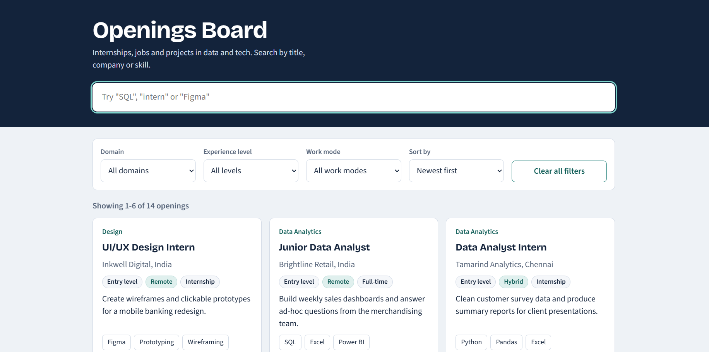
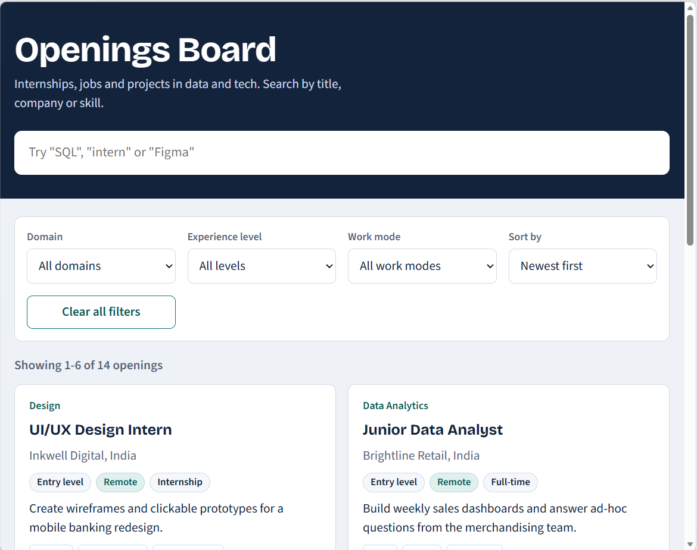
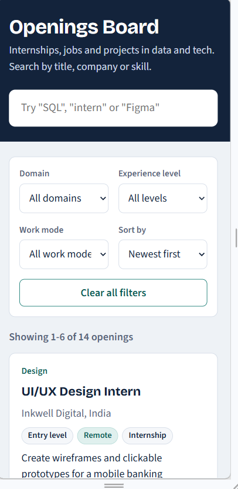
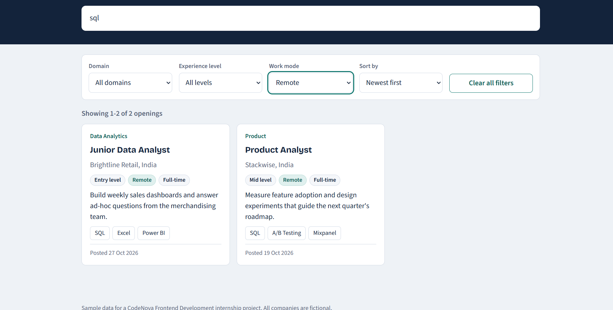
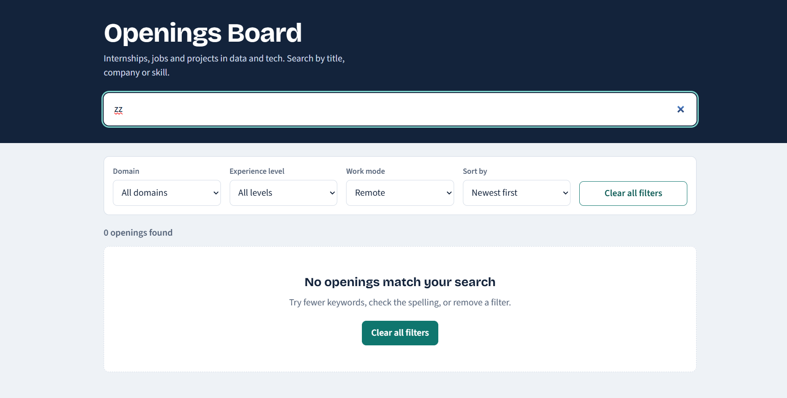

# Openings Board

A searchable, filterable listing dashboard for entry-level data and tech openings. Built for **CodeNova Frontend Development Internship, Batch 01, Task 4**.

**Live demo:** https://vinisha8904.github.io/openings_board/
## Screenshots







## Features

- Cards rendered dynamically from a local JSON file (14 listings)
- Live search across title, company, domain, summary and skills
- Filters for domain, experience level and work mode
- Sorting: newest first, title A to Z, title Z to A
- Pagination (6 cards per page)
- Loading, empty and error states
- Clicking a skill tag on a card searches for that skill
- Responsive layout with no horizontal scrolling, keyboard accessible, touch-friendly controls

## Tech stack

HTML5, CSS3 (Grid, Flexbox, custom properties), vanilla JavaScript (Fetch API, array methods). No frameworks, no paid tools, no API keys.

## Project structure

```
openings-board/
  index.html
  style.css
  script.js
  data/listings.json
  README.md
```

## How to run locally

`fetch()` does not work on files opened with `file://`, so use a local server:

- **VS Code:** install the "Live Server" extension, right-click `index.html`, choose "Open with Live Server"
- **Or with Python:** run `python -m http.server 8000` in the project folder, then open http://localhost:8000

## How it works

### State
One `state` object holds the data and every control's current value (query, filters, sort, page). Each user action updates `state`, then `render()` redraws the page from it.

### Filtering and the search algorithm
1. When the data loads, each listing gets a hidden lowercase string joining its title, company, domain, summary and skills.
2. The typed query is lowercased and split into words.
3. A listing matches only if **every word** appears in its string. Searching `sql intern` finds listings containing both words.
4. The domain, level and work-mode filters are then applied. All conditions are joined with logical **AND**, so search and filters work together.

Pre-building the search string once means each keystroke only does cheap `includes()` checks, so filtering feels instant.

### Debouncing
The search box does not filter on every keystroke. `debounce()` waits 250 ms after the user stops typing, then runs the search once. This avoids redrawing the list many times while typing.

### Sorting
`newest` compares the ISO date strings (`YYYY-MM-DD`), which sort correctly as text. The A to Z and Z to A options use `localeCompare` on the title.

### Pagination
After filtering and sorting, `slice()` takes 6 items for the current page. Any filter or search change returns to page 1.

### UI states
| State | When it shows |
|-------|---------------|
| Loading | While the JSON file is being fetched |
| Empty | No listing matches the search and filters. Offers a "Clear all filters" button |
| Error | The fetch fails or the data is invalid. Shows the reason and a "Try again" button |

### Security
Cards are built with `textContent` and DOM methods, never `innerHTML`, so data in the JSON cannot inject HTML or scripts.

## Data

`data/listings.json` has 14 sample listings. All companies are fictional. Each entry has `id`, `title`, `company`, `domain`, `level`, `workMode`, `location`, `type`, `skills`, `postedOn` and `summary`.

## Deployment

Hosted free on GitHub Pages: repository Settings, Pages, deploy from the `main` branch, root folder.
